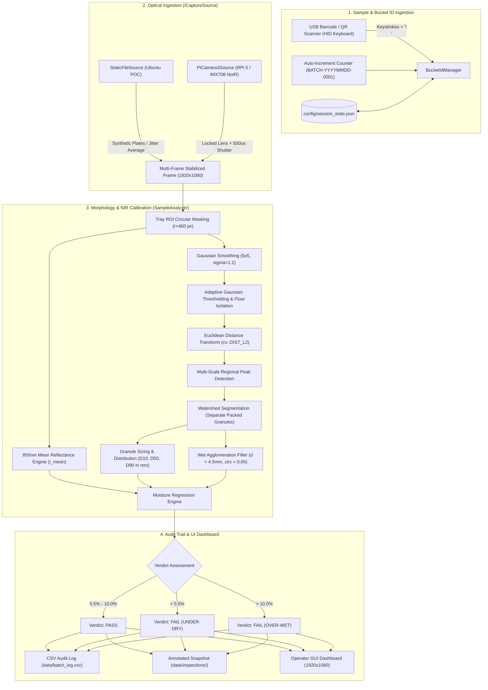

# Calcium Hypochlorite Benchtop Quality & Moisture Inspection Station

[](https://en.wikipedia.org/wiki/C%2B%2B17)
[](https://cmake.org/)
[](https://opencv.org/)
[](https://www.raspberrypi.com/)
[](LICENSE)

A standalone, industrial-grade C++ (C++17) benchtop quality inspection application for **Calcium Hypochlorite** grab samples, utilizing OpenCV, multi-modal Barcode/QR ingestion, 850nm Near-Infrared (NIR) surface reflectance, and watershed granule morphology.

Designed for native development and simulation on **Ubuntu Linux (x86_64)** and direct edge deployment to **Raspberry Pi 5 (ARM64)** paired with the **Raspberry Pi Camera Module 3 NoIR** and an **850nm LED Ring Illuminator**.

---

## Table of Contents
1. [Safety & Chemical Overview](#safety--chemical-overview)
2. [System Architecture](#system-architecture)
3. [Key Features](#key-features)
4. [Mathematical & Optical Models](#mathematical--optical-models)
5. [Hardware Specifications](#hardware-specifications)
6. [Prerequisites & Installation](#prerequisites--installation)
7. [Building the System](#building-the-system)
8. [Running the Application](#running-the-application)
9. [Operator Controls & Keybindings](#operator-controls--keybindings)
10. [Configuration Reference](#configuration-reference)
11. [Audit Trail & Inspection Logs](#audit-trail--inspection-logs)
12. [Raspberry Pi 5 Deployment Guide](#raspberry-pi-5-deployment-guide)
13. [Running Tests](#running-tests)

---

## Safety & Chemical Overview

**Calcium Hypochlorite hydrated granules** (*UN 2880, Class 5.1 Oxidizer*) require tight moisture regulation:
* **Safe Commercial Window (5.5% to 10.0% H₂O)**: Standard stabilized hydrated Cal Hypo.
* **Critical Hazard: Under-Dry (< 5.5% H₂O)**: Anhydrous / under-dry Cal Hypo is thermodynamically unstable, creating extreme sensitivity to heat and organic contaminants with high risk of **spontaneous deflagration / thermal runaway**.
* **Quality Rejection: Over-Wet (> 10.0% H₂O)**: Excess water causes chemical decomposition into chlorine gas and chlorates, caking/agglomeration, and drum pressure bulging.

This inspection system evaluates grab samples from packaged production buckets in under 500 ms, delivering an instant **PASS / FAIL** audit verdict before shipment.

---

## System Architecture



---

## Key Features

1. **Multi-Modal Bucket ID Management (`BucketIdManager`)**:
   - **Primary**: USB Barcode / QR scanner operating in HID keyboard emulation mode. Buffers incoming characters in the GUI event loop until Enter (`\n` / `\r`) is received, then atomically commits the ID and arms optical capture.
   - **Secondary**: Auto-incrementing batch prefix fallback (`BATCH-<YYYYMMDD>-<0001>`). Daily resets and counter persistence stored in `config/session_state.json`.
   - **Tertiary**: Manual override mode via keyboard `[M]` prompt.

2. **Advanced Morphology & Sizing Engine (`SampleAnalyzer`)**:
   - Circular Region-of-Interest (ROI) petri dish masking.
   - Contact separation of packed granules via **Distance Transform** and **Watershed Segmentation**.
   - Cumulative particle size percentiles: **D10**, **D50 (median)**, and **D90** computed via equivalent circular diameter $d = 2 \times \sqrt{\text{Area} / \pi} \times \text{scale\_factor}$.
   - Agglomeration detection flags wet cakes and aggregates ($d > 4.5$ mm and circularity $\frac{4\pi \times \text{Area}}{\text{Perimeter}^2} < 0.65$).

3. **850nm NIR Reflectance & Moisture Calibration**:
   - Water molecules absorb 850nm NIR light, attenuating surface reflectance.
   - Computes mean pixel intensity $I_{\text{mean}}$ strictly over granule surfaces.
   - Regression engine correlates NIR absorption and clumping ratio to estimate moisture percentage.

4. **Desktop Simulation & Hardware Abstraction (`ICaptureSource`)**:
   - `StaticFileSource`: Ingests test images with simulated multi-frame sensor noise averaging. Automatically generates synthetic dry, wet, and under-dry sample plates on first run if assets are missing.
   - `PiCamera3Source`: Direct V4L2/libcamera capture with manual focus lock and fixed 500 $\mu$s exposure on Raspberry Pi 5.

5. **Tamper-Evident CSV Audit Trail (`ReportLogger`)**:
   - Writes all inspections to `data/batch_log.csv` and calls `flush()` immediately to prevent data loss during benchtop power interruptions.
   - Saves annotated inspection screenshots with green granule boundaries and red clump bounding boxes to `data/inspections/<BucketID>_<timestamp>.jpg`.

6. **Industrial Operator GUI Dashboard (`UI`)**:
   - 1920x1080 dashboard with live camera viewport, prominent Active Bucket ID badge, hero moisture card, safe-tolerance gauge, particle telemetry, and scanner status.
   - Seamless headless execution mode for remote CI/CD pipelines or headless ARM boards.

---

## Mathematical & Optical Models

### 1. Moisture Regression Formula
$$\text{Moisture } \% = \alpha - (\beta \times I_{\text{mean}}) + \left(\gamma \times \frac{\text{Clump Area}}{\text{Total Granule Area}}\right)$$

- **$\alpha$** (Offset intercept): Default `19.5`
- **$\beta$** (NIR attenuation slope): Default `0.075` (lower $I_{\text{mean}}$ due to water absorption increases moisture)
- **$\gamma$** (Agglomeration weight): Default `12.0` (wet cake capillary binding increases moisture)

### 2. Particle Sizing & Cumulative Percentiles
For each particle $i$ with contour area $A_i$ (pixels) and calibrated spatial resolution $s = 0.05$ mm/pixel:
$$d_i = 2 \times \sqrt{\frac{A_i}{\pi}} \times s$$

Sorted in ascending order $d_1 \le d_2 \le \dots \le d_N$:
- **D10**: 10th percentile diameter (fine granules)
- **D50**: 50th percentile median diameter
- **D90**: 90th percentile diameter (coarse granules)

### 3. Agglomerate (Wet Clump) Condition
A particle is classified as an agglomerate if both criteria are met:
1. $d_i > 4.5\text{ mm}$
2. Circularity $C_i = \frac{4\pi A_i}{P_i^2} < 0.65$

---

## Hardware Specifications

| Component | Specification | Function |
| :--- | :--- | :--- |
| **SBC** | Raspberry Pi 5 (4GB / 8GB RAM) | Core processing host |
| **Camera Sensor** | Raspberry Pi Camera Module 3 NoIR (Sony IMX708, 12MP) | High-quantum-efficiency 850nm NIR imaging without IR-cut filter |
| **Optics** | Fixed focal lock (`--lens-position` locked) | Suppresses VCM autofocus hunting inside enclosed chamber |
| **Illumination** | 850nm Infrared LED Ring Illuminator (12V DC, Diffused) | Dark-field circular illumination of granule dish |
| **Enclosure** | Benchtop Lightbox Drawer (Matte Dark Interior, 45-55 DN) | Eliminates ambient factory stray light |
| **Scanner** | USB Barcode / QR 2D Scanner (HID Keyboard Emulation) | Fast operator bucket barcode scanning |

---

## Prerequisites & Installation

### Ubuntu Linux (22.04 LTS / 24.04 LTS)
```bash
sudo apt-get update
sudo apt-get install -y \
    build-essential \
    cmake \
    pkg-config \
    libopencv-dev \
    nlohmann-json3-dev
```

---

## Building the System

```bash
# Clone the repository
git clone https://github.com/your-org/Hypo-Moisture-Analyser.git
cd Hypo-Moisture-Analyser

# Configure and compile with CMake
cmake -B build -S .
cmake --build build -j$(nproc)
```

The build produces two binaries in `build/`:
- `build/hypo_inspector`: Main benchtop quality inspection application.
- `build/test_hypo`: Comprehensive automated test suite.

---

## Running the Application

### 1. Interactive Desktop GUI (Default)
```bash
./build/hypo_inspector
```
*Note: If no sample images exist in `data/sample_images/`, the system automatically synthesizes `dry_sample.png`, `wet_sample.png`, and `underdry_sample.png` on the first launch.*

### 2. Automated Batch / Headless Mode
Run automated scans across available test samples without opening a GUI window:
```bash
./build/hypo_inspector --batch 3 --headless
```

### 3. Inspect a Specific Grab Sample Image
```bash
./build/hypo_inspector --sample data/sample_images/wet_sample.png --bucket-id LOT-HYPO-4091 --batch 1
```

### 4. Command-Line Options
```
Usage: ./build/hypo_inspector [options]

Options:
  --config <path>       Path to configuration JSON (default: config/settings.json)
  --headless            Run in headless mode (no GUI window)
  --batch <N>           Run N automated inspections on available samples and exit
  --sample <path>       Directly specify initial sample image path
  --bucket-id <id>      Set initial Bucket ID
  --help                Show this help message
```

---

## Operator Controls & Keybindings

| Key / Input | Action |
| :--- | :--- |
| **[USB Barcode Scan]** | Scanner transmits barcode characters terminating with `\n`. Arms capture and runs inspection immediately. |
| **[SPACE]** | Triggers capture & inspection on the active Bucket ID. |
| **[A]** | Generates next auto-incrementing Batch ID (`BATCH-YYYYMMDD-XXXX`). |
| **[N]** | Cycles to the next test sample plate (`dry_sample.png` $\leftrightarrow$ `wet_sample.png`). |
| **[M]** | Prompts for manual Bucket ID entry in the terminal console. |
| **[Backspace]** | Deletes the last character in the barcode buffer. |
| **[ESC] / [Q]** | Clears active input buffer or exits the application. |

---

## Configuration Reference

System parameters are loaded from `config/settings.json`:

```json
{
    "system": {
        "chamberName": "Benchtop-Station-01",
        "cameraMode": "static_file",
        "headless": false,
        "sampleImageDir": "data/sample_images",
        "defaultSampleImage": "data/sample_images/dry_sample.png"
    },
    "camera": {
        "frameWidth": 1920,
        "frameHeight": 1080,
        "shutterSpeedUs": 500,
        "analogGain": 1.0,
        "lensPosition": 0.0,
        "frameAverageCount": 4,
        "deviceIndex": 0
    },
    "morphology": {
        "scaleFactorMmPerPixel": 0.05,
        "clumpThresholdMm": 4.5,
        "circularityThreshold": 0.65,
        "minGranuleAreaPx": 25.0,
        "gaussianBlurKernel": 5,
        "adaptiveBlockSize": 25,
        "adaptiveC": -5.0,
        "roiCenterX": 960,
        "roiCenterY": 540,
        "roiRadiusPx": 460,
        "autoDetectDish": false
    },
    "calibration": {
        "alpha": 19.5,
        "beta": 0.075,
        "gamma": 12.0
    },
    "quality": {
        "minMoisturePct": 5.5,
        "maxMoisturePct": 10.0
    },
    "batch": {
        "batchPrefix": "BATCH",
        "batchLogPath": "data/batch_log.csv",
        "inspectionsDir": "data/inspections",
        "sessionStatePath": "config/session_state.json"
    }
}
```

---

## Audit Trail & Inspection Logs

### CSV Log (`data/batch_log.csv`)
Each test automatically appends a record immediately flushed to disk:
```csv
Timestamp,BucketID,D10_mm,D50_mm,D90_mm,ClumpCount,MeanIR,MoisturePct,Verdict
2026-10-12 12:19:35,BATCH-20261012-0005,1.68,2.12,2.51,0,160.4,7.47,PASS
2026-10-12 12:19:35,BATCH-20261012-0006,1.58,1.88,2.30,0,195.9,4.81,FAIL (UNDER-DRY)
2026-10-12 12:19:36,BATCH-20261012-0007,1.38,2.05,4.25,4,111.1,19.10,FAIL (OVER-WET)
```

### Inspection Snapshots (`data/inspections/`)
Saved image files:
- `data/inspections/<BucketID>_<timestamp>.jpg`: Segmented granule viewport with green circles for valid granules, red contours/bounding boxes for clumps, and telemetry watermark.
- `data/inspections/dashboard_<BucketID>.jpg`: Complete rendered 1920x1080 operator dashboard screenshot.

---

## Raspberry Pi 5 Deployment Guide

### 1. Enable Camera & V4L2 Drivers
On Raspberry Pi OS (Bookworm 64-bit):
```bash
sudo raspi-config
# Interface Options -> Camera -> Enable
sudo apt-get update && sudo apt-get install -y libcamera-dev libcamera-tools libopencv-dev
```

### 2. Configure Settings for Hardware
Edit `config/settings.json` on the Raspberry Pi:
```json
{
    "system": {
        "cameraMode": "picamera3"
    },
    "camera": {
        "shutterSpeedUs": 500,
        "analogGain": 1.0,
        "lensPosition": 0.0,
        "frameAverageCount": 4
    }
}
```

### 3. USB Barcode Scanner Setup
Plug the USB Barcode Scanner into any Raspberry Pi USB port. Ensure the scanner is configured in **USB HID Keyboard** mode with terminating suffix set to **CR/LF (Enter)** (default factory setting on most Honeywell, Zebra, and Netum scanners).

---

## Running Tests

Run the full automated unit and integration test suite:

```bash
# Using CTest
ctest --test-dir build --output-on-failure

# Or run the test executable directly
./build/test_hypo
```

Test coverage includes:
1. `BucketIdManager`: USB HID keystroke buffering, newline triggering, auto-increment pattern, session state persistence.
2. `Config`: JSON loading, serialization, and fallback validation.
3. `SampleAnalyzer`: Accuracy of D10/D50/D90 percentile calculations, clump circularity/size filtering, NIR reflectance correlation, and PASS / FAIL verdict boundaries.
4. `ReportLogger`: CSV schema integrity and file system snapshot persistence.

---

## License
MIT License. Copyright (c) 2026 Antigravity Quality Inspection Systems.

